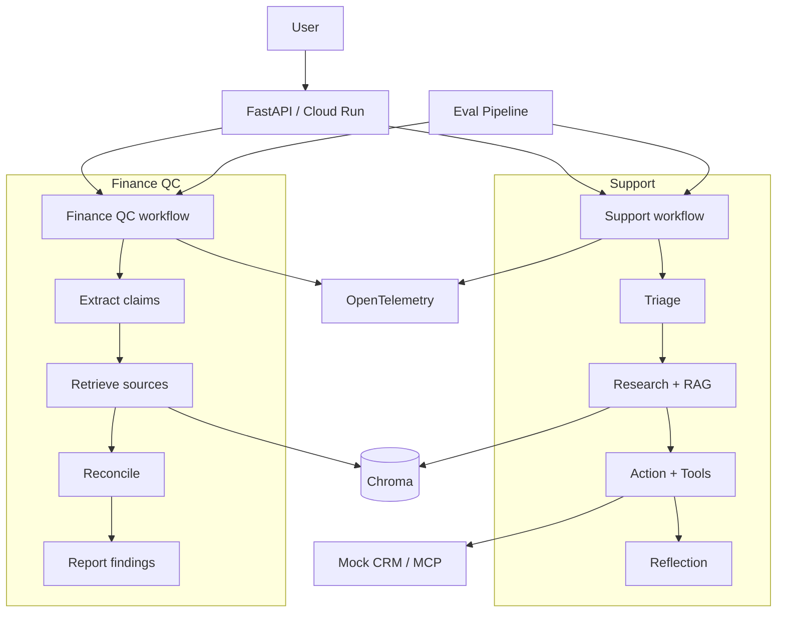

# FieldOps Agent Fabric

Multi-agent automation for B2B SaaS: support triage with RAG-grounded answers and CRM tools, plus finance reporting quality control that reconciles narrative claims against authoritative tables and KPI definitions.

**Try it locally:** `make api` → http://localhost:8080/docs (no cloud credentials required)  
**Deploy:** [docs/DEPLOY_GCP.md](docs/DEPLOY_GCP.md)

[](https://github.com/adhirajpathak/fieldops-agent-fabric/actions)

## Who it's for

Support, operations, and finance teams at B2B SaaS companies that need AI copilots which:

- Classify and route inbound tickets (billing, incidents, account, general)
- Answer from approved policy docs instead of free-form model memory
- Create and update tickets in existing CRM / ITSM systems (with HITL approval on writes)
- Reconcile board narratives and flash reports against forecast tables and KPI glossaries
- Expose cost, latency, and audit trails for production review

Mock CRM/ticketing tools are included so you can run the full support workflow without connecting a live system of record.

## Architecture



| Layer | What it does |
|-------|----------------|
| Support workflow | Triage → research → action → reflection |
| Finance QC workflow | Extract → retrieve → reconcile → report |
| RAG | Shared Chroma index over policies + finance docs |
| MCP tools | `mcp_servers/enterprise_mock` — CRM lookup, ticket create/list |
| LLM providers | `mock`, Vertex AI, OpenAI, or AWS Bedrock |
| Observability | Token/cost/latency metrics; OpenTelemetry spans (optional GCP Trace) |
| Eval | Support + finance golden sets with per-suite metrics |

An optional [Agent Development Kit](https://google.github.io/adk-docs/) skeleton lives in `src/fieldops/agents/adk_example.py` for GCP-native agent packaging.

## Quick start

```bash
git clone https://github.com/adhirajpathak/fieldops-agent-fabric.git
cd fieldops-agent-fabric
python -m venv .venv && source .venv/bin/activate
pip install -e ".[dev,gcp]"   # Python 3.11+

cp .env.example .env   # LLM_PROVIDER=mock
make ingest && make test && make eval
make api               # http://localhost:8080/docs
```

Example support request:

```bash
curl -s -X POST http://localhost:8080/v1/support \
  -H 'Content-Type: application/json' \
  -d '{"query":"Enterprise customer reports us-central1 outage affecting payments","customer_id":"cust-1001"}' | jq
```

Example finance reconcile:

```bash
curl -s -X POST http://localhost:8080/v1/finance/reconcile \
  -H 'Content-Type: application/json' \
  -d '{"document_ref":"finance/q2-board-deck-narrative.md"}' | jq
```

## Evaluation

Golden sets:

- Support: `data/eval/golden_cases.jsonl` — category accuracy and required answer content
- Finance: `data/eval/finance_cases.jsonl` — planted narrative/table mismatches, clean docs, rounding and unit edges

```bash
make eval                 # both suites
fieldops-eval support     # support only
fieldops-eval finance     # finance only
```

Example report shape:

```json
{
  "suites": {
    "support": {"cases": 3, "passed": 3, "pass_rate": 1.0},
    "finance": {"cases": 8, "passed": 8, "pass_rate": 1.0}
  },
  "cases": 11,
  "passed": 11,
  "pass_rate": 1.0
}
```

Each `/v1/support` and `/v1/finance/reconcile` response includes per-request metrics for cost and latency tracking.

## LLM providers

| Provider | When to use | Setup |
|----------|-------------|--------|
| `mock` | Local dev and CI (default) | `LLM_PROVIDER=mock` |
| Vertex AI | GCP production | `LLM_PROVIDER=vertex` + ADC / Cloud Run SA |
| OpenAI | Local or non-GCP deploys | `pip install -e ".[openai]"` + `OPENAI_API_KEY` |
| AWS Bedrock | AWS production | `pip install -e ".[bedrock]"` + `LLM_PROVIDER=bedrock` + `AWS_REGION` / `BEDROCK_MODEL_ID` |

Vertex example:

```bash
export LLM_PROVIDER=vertex
export GOOGLE_CLOUD_PROJECT=your-project
export GOOGLE_CLOUD_REGION=us-central1
gcloud auth application-default login
make ingest && make eval
```

Bedrock example:

```bash
pip install -e ".[bedrock]"
export LLM_PROVIDER=bedrock
export AWS_REGION=us-east-1
export BEDROCK_MODEL_ID=anthropic.claude-3-5-haiku-20241022-v1:0
# Uses the default AWS credential chain (env, profile, or instance role)
make ingest && make eval
```

## Deploy

Production target is **Cloud Run** with optional Vertex AI and Cloud Trace. Full steps: [docs/DEPLOY_GCP.md](docs/DEPLOY_GCP.md).

```bash
gcloud builds submit --tag REGION-docker.pkg.dev/PROJECT/fieldops-agent-fabric/api:latest
cd infra/terraform && terraform init && terraform apply -var="project_id=PROJECT"
```

Terraform provisions Artifact Registry and Cloud Run. Push the image before `terraform apply`. After deploy, health lives at `/health` (Cloud Run reserves `/healthz` at the edge).

## Repository layout

```
src/fieldops/          # Application code
  agents/              # Support + finance LangGraph workflows
  rag/                 # Shared ingest + Chroma retriever
  tools/               # Enterprise API shims
  security/            # Authz + HITL approvals
  observability/       # Metrics + tracing
  api/                 # FastAPI (Cloud Run entry)
  eval/                # Multi-suite runner
mcp_servers/           # MCP tool server (mock CRM / ticketing)
data/
  knowledge_base/      # Support policies + finance docs
  eval/                # Support + finance golden sets
infra/terraform/       # Cloud Run + Artifact Registry
docs/                  # Deployment notes
```

## Roadmap

- Managed search (e.g. Vertex AI Search) as an alternative RAG backend
- Full ADK agent path alongside LangGraph
- BigQuery sink for eval metrics and dashboards
- Safety evals (jailbreak set + refusal rate)
- Deeper finance period matching and workbook imports

## License

Apache-2.0
